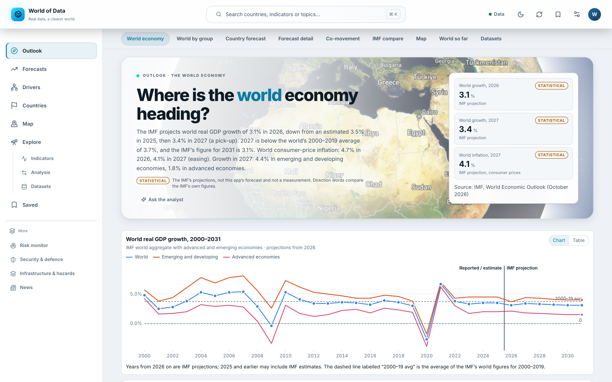
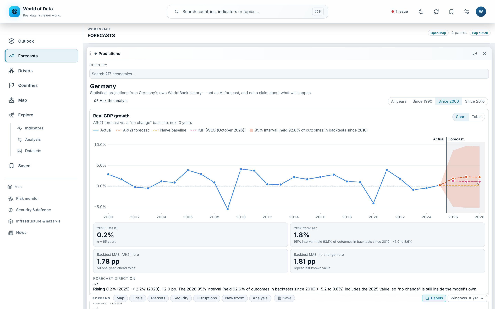
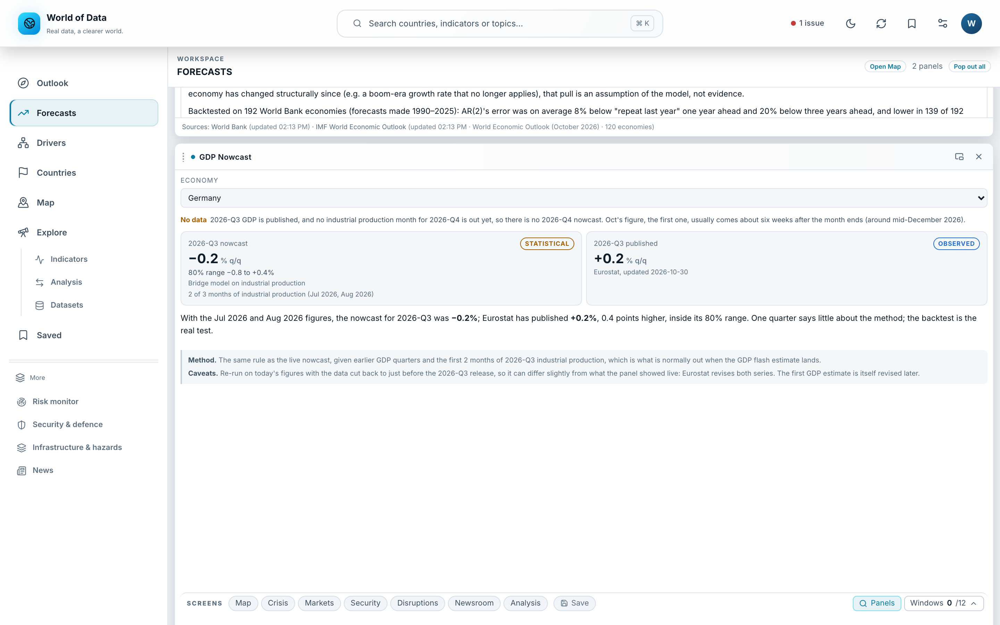
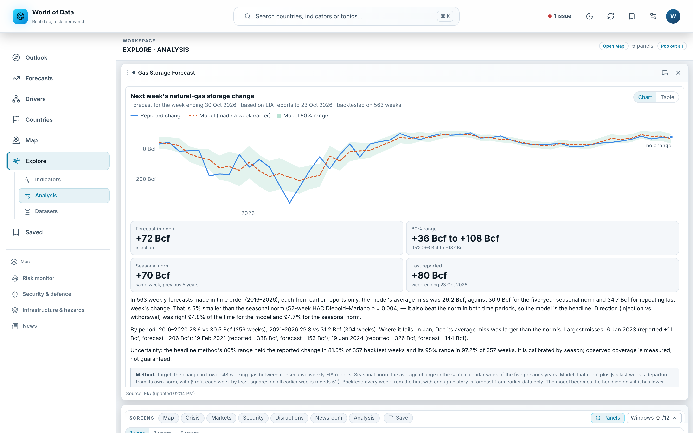
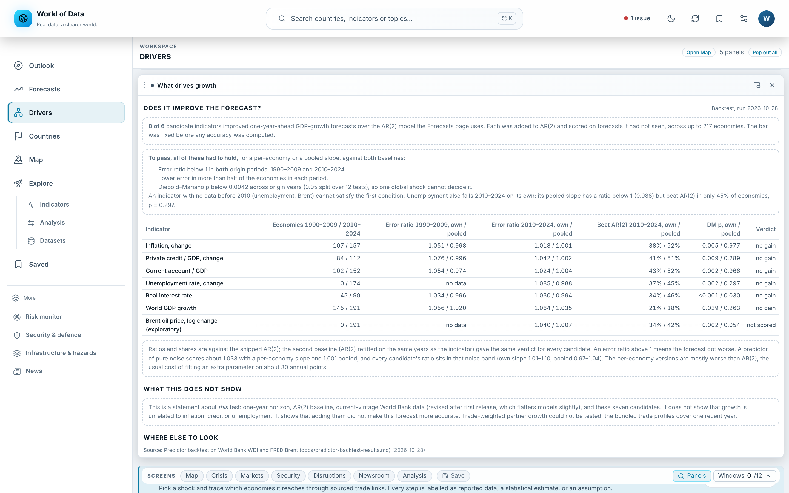
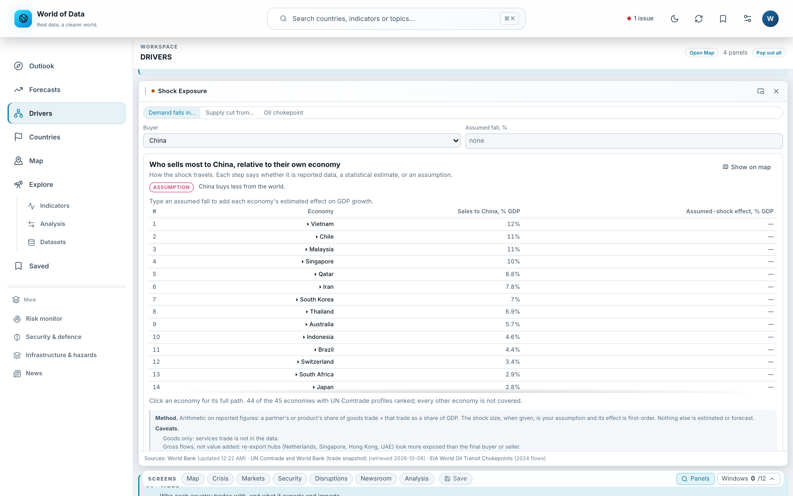
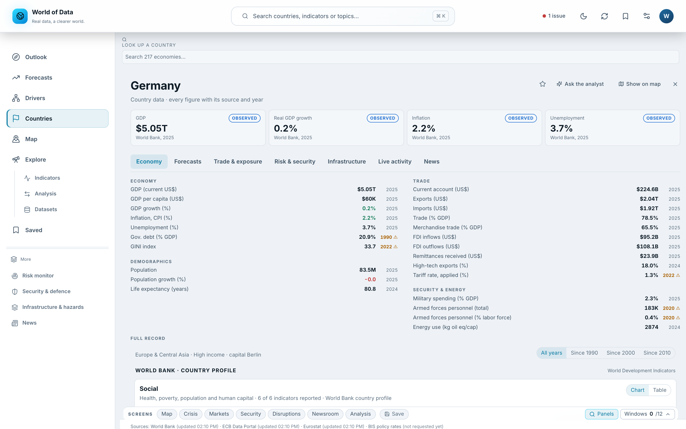
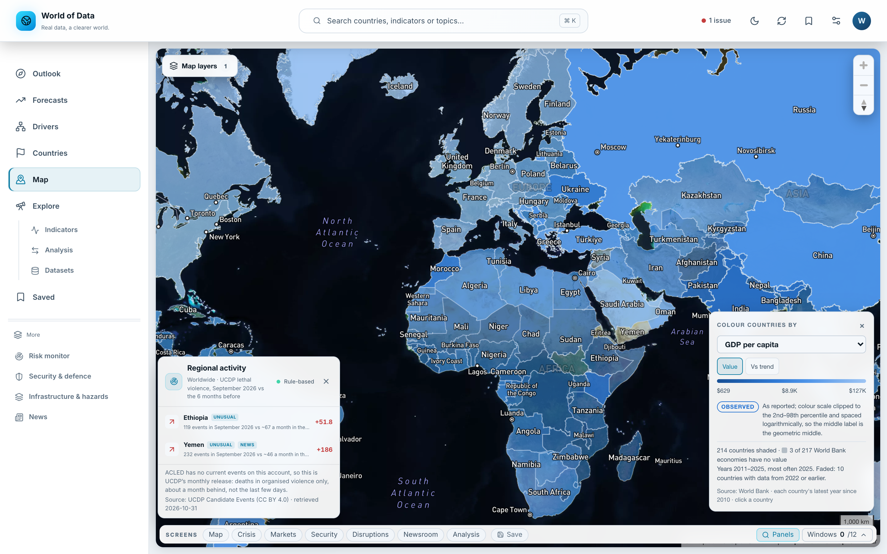
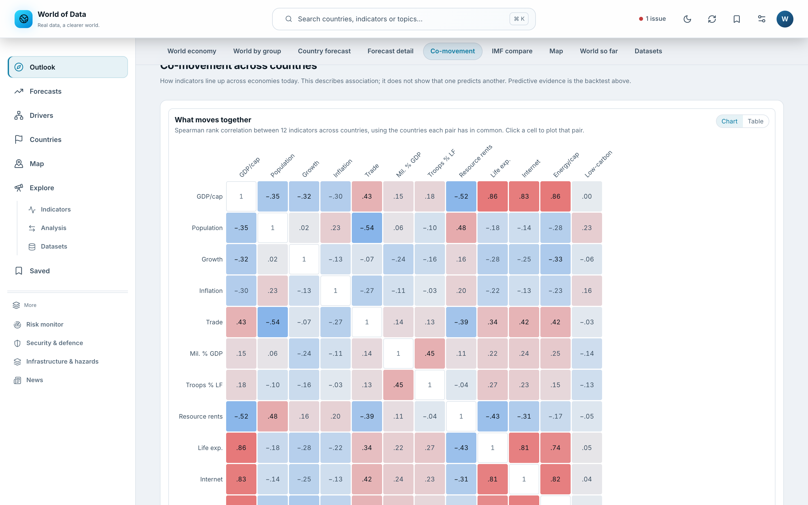
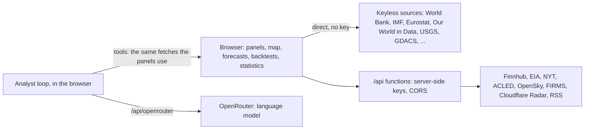

# World of Data

An economic outlook dashboard. It forecasts GDP growth for 217 economies, tests every forecast against a naive baseline and the IMF, and traces how a shock spreads through sourced trade links. A map, country pages and an AI analyst sit on top of the same data.

   



Every number is computed in the browser from public data. Each one is labelled as **observed** (as the source reports it), **statistical** (estimated, with its uncertainty) or **assumption** (set by the user or a scenario), and carries its source and year.

## Forecasts

Statistical projections with the backtest that decides whether each is shown. Not AI output.



**GDP, inflation and unemployment for 217 economies.** The model for each series was picked by a rolling-origin backtest across every World Bank economy. AR(2) won for GDP growth: 8% below "no change" one year ahead on average, though the IMF still beats it in 142 of 185 economies. For inflation and unemployment no model tested beat "no change", so that is what is shown. Intervals were calibrated on forecasts made before 2010, and the label states what they held since. Each card also backtests the model on the selected country and says when it doesn't win.

| | |
|---|---|
|  |  |
| **GDP nowcast (EU)**: this quarter's growth before Eurostat publishes it, from industrial production. The rule was committed before any real data was scored. It is the headline only where it beat "same as last quarter" in both 2005–2014 and 2015 on (16 of 27 economies on the first run). | **Gas storage, next week**: the five-year seasonal norm plus a share of last week's departure from it. Over 563 out-of-sample weeks (2016–2026, as of 30 Oct 2026) its average miss was 29.2 Bcf against 30.9 Bcf for the norm (Diebold–Mariano, p = 0.004), and its 80% range held 81.5% of outcomes. |

**Forecast memory.** The app records each forecast in the browser when its inputs change, says what changed since the last visit (new data, a model switch, a new IMF edition), and scores past forecasts once their outcome is published. Nothing is backfilled, so the track record starts empty.

## Drivers and shocks



**What drives growth.** Six candidate indicators (inflation, private credit, current account, unemployment, real interest rate, world growth) were each added to AR(2) and scored on forecasts the model had not seen. The pass bar was fixed before any accuracy was computed. None of the six passed, and the page says so. See [`docs/predictor-backtest-results.md`](docs/predictor-backtest-results.md).



**How shocks spread.** Pick a shock ("China buys less", "supply from Russia is cut", "Hormuz closes") and see which economies it reaches, through which link, and how much as a share of their GDP. Each step is shown with its source and year. Shares outside a country's reported top partners become ranges, never guesses. With an assumed shock size, the implied change in GDP growth is added as a statistical step, with its interval. Results are first-order: goods only, no rerouting.

## Countries, map and comparisons

| | |
|---|---|
|  |  |
| **Country pages**: the economy first (World Bank figures with year and freshness, IMF projections, the forecast), then trade exposure, risk and security, infrastructure, live activity and news. | **The map** colours countries by any of 50 indicators (World Bank, Our World in Data, Ember), either by value or by distance from the trend. It shows coverage and fades stale values. Overlays add conflict events, disasters, outages, energy infrastructure, trade routes and chokepoints. |



**What moves together**: Spearman rank correlations across countries for twelve indicators, with a scatter, trend line and outliers for any pair you click. This is association between countries at one point in time. It is not evidence that one indicator predicts another; the Drivers page tests that.

## AI analyst


The analyst answers by requesting the dashboard's own data, not from memory. It writes a request such as `[DATA:series|Germany,France|GDP growth]`. The browser runs it against the same services the panels use and returns the result with an id (R1, R2, …) for the model to cite, for up to four rounds. Forecasts, statistics and charts are computed locally. The model writes `[CHART:R2]` and the panel draws that result's data, so it cannot supply a plotted value. Every answer shows its investigation trail: each query, its source and the exact text the model received.

It runs on any OpenRouter model, and the default is a free one. A rule-based Watchlist sits beside the chat and flags countries whose conflict activity is unusually high for them, without a prompt.

**Not measured:** whether the analyst's answers are accurate. [`src/services/analystBench.ts`](src/services/analystBench.ts) holds twelve questions and an offline scorer for known failure classes (answering a change question from levels, citing results never fetched, stating figures no result contains). No benchmark results have been published yet.

## How it works



There is no database and no application server. State lives in the browser. A few small functions in `api/` keep API keys off the client and add CORS headers where a source has none. Every data source is free. Where a key is needed, it is on the provider's free tier.

Curated datasets (military sites, energy sites, sanctions, …) are entered by hand from named sources. [`DATA_PROVENANCE.md`](DATA_PROVENANCE.md) lists each source and what has been re-verified. Architecture and conventions are in [`ARCHITECTURE.md`](ARCHITECTURE.md).

## Run it

```bash
npm install
cp .env.example .env   # only VITE_MAPBOX_TOKEN is required; every other key is optional
npm run dev            # Vite plus the /api functions, on http://localhost:3000
npm test               # about 2,000 tests, fully offline
npm run typecheck
```

The test suite is hermetic: any network call a test doesn't mock fails, so it runs offline and in CI with no keys.

Stack: Vite, React 18, TypeScript (strict), Mapbox GL v3, plain SVG charts.
