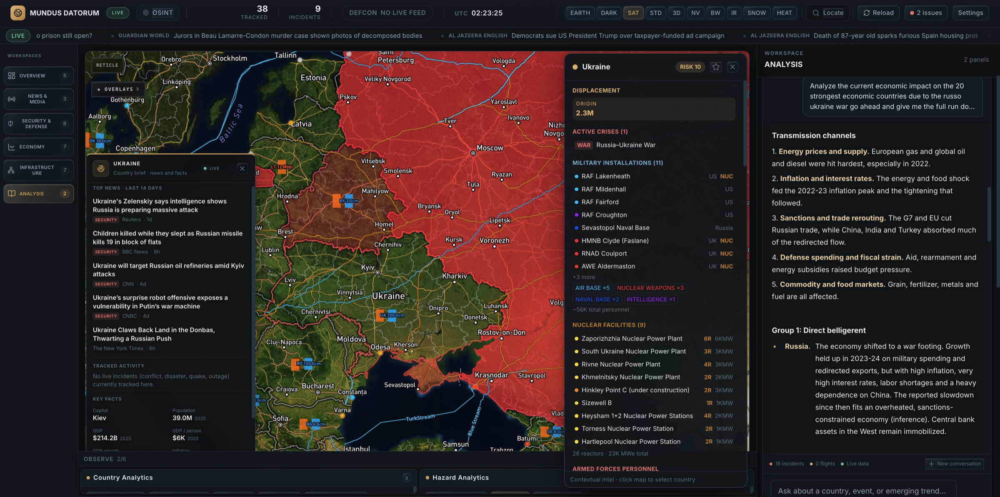
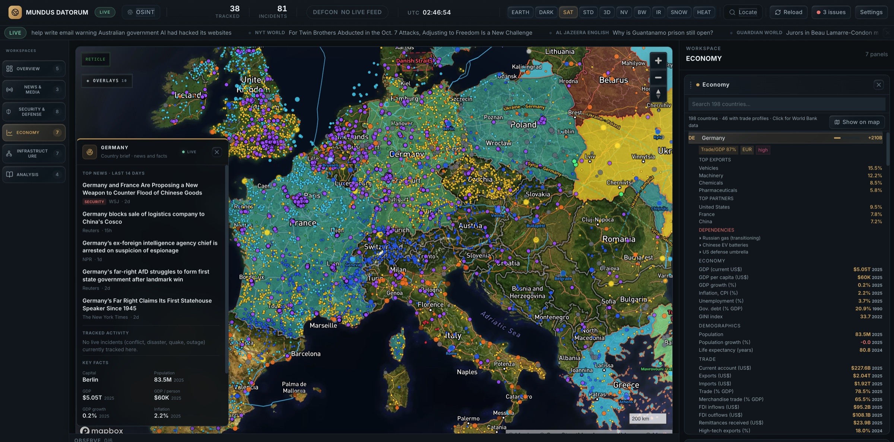
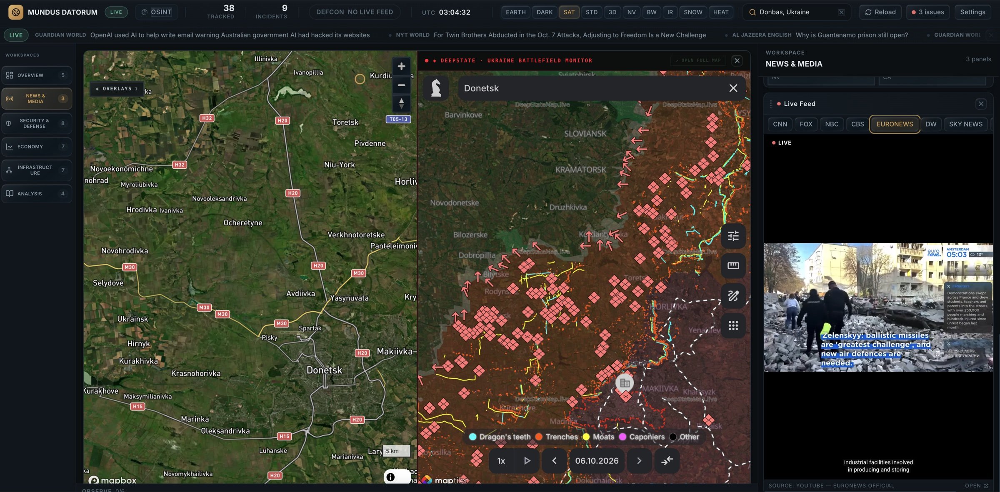
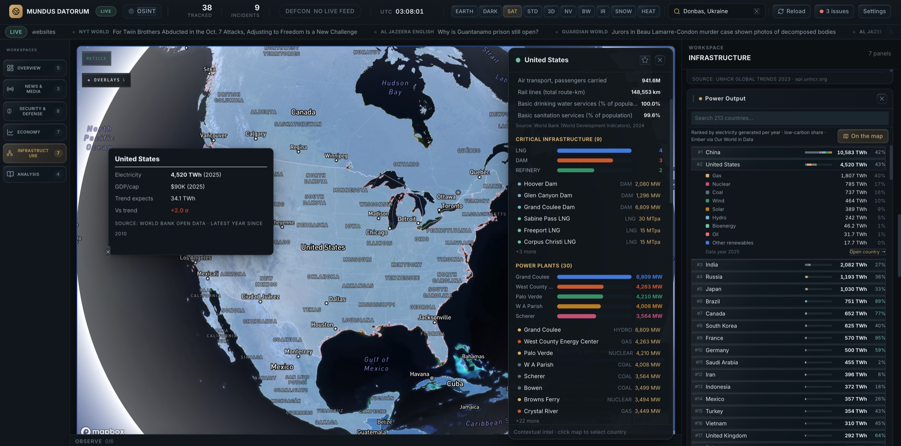
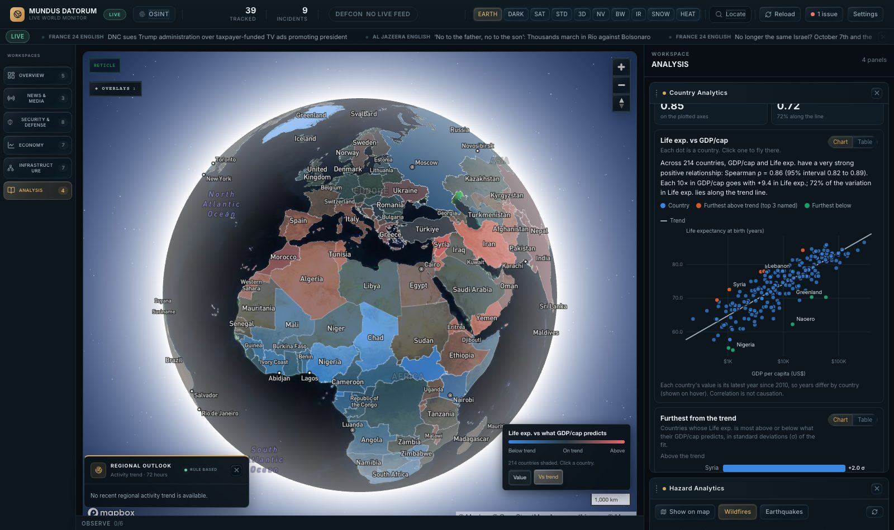
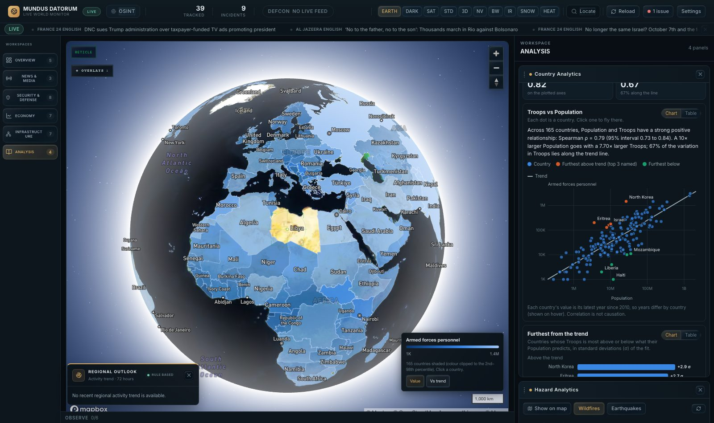
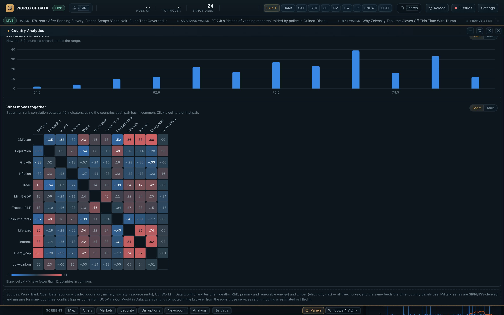
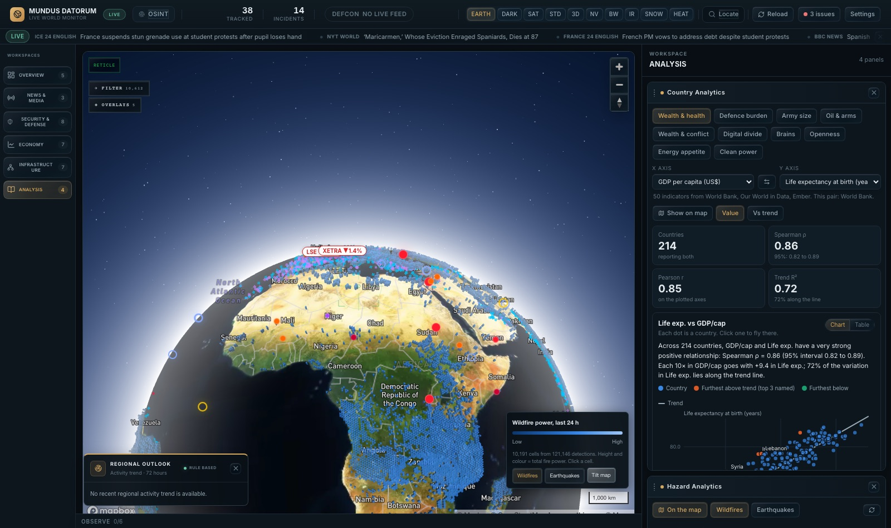
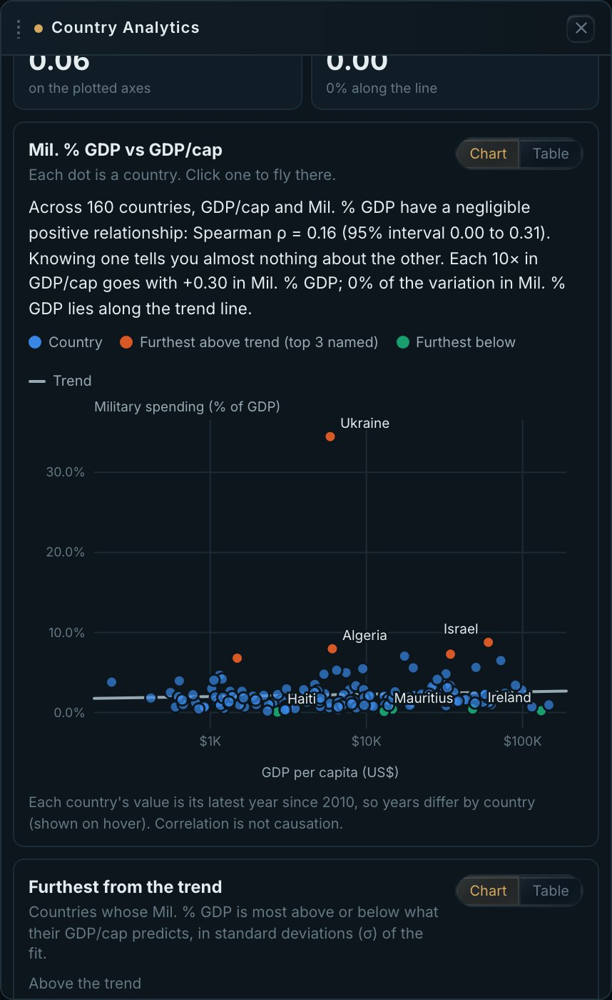
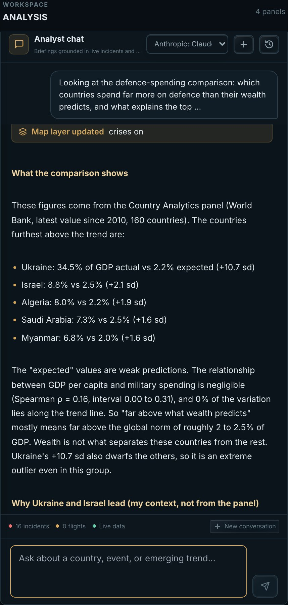

# Macroeconomic Forecasting System

A statistical forecasting system for macroeconomic, political and industrial indicators — GDP growth, inflation, unemployment, trade, sanctions, debt dynamics — backtested against naive baselines, with a 3D globe used to visualise the underlying data. It is a research case around two questions: **what does data become when you visualise it, and what happens when an LLM is wired into a system that can evaluate all of it?**

   



## 29 overlays in 5 categories



| Category | Overlays |
|---|---|
| **Live tracking** | flights (OpenSky), vessels (AIS), webcams |
| **Events & hazards** | crises, news, wildfires (NASA FIRMS), humanitarian, GPS jamming, internet outages, hazard hexagons |
| **Security & defence** | military sites, force size, nuclear, sanctions, airspace |
| **Economy** | markets, trade, resources, oil, gas, supply chain, country data |
| **Infrastructure** | energy sites, data centres, pipelines, ports, chokepoints, shipping density |



Split view: the satellite map beside the embedded DeepState Ukraine battlefield monitor, with a live news feed in the dock.



Infrastructure workspace on the United States: the country panel lists its dams, LNG terminals, refineries and largest power plants, and the dock ranks countries by electricity generated (Ember via Our World in Data).

## Analytics

Pick any two of **50 country indicators** (World Bank, Our World in Data, Ember) and get the trend, Spearman correlation with a 95% interval, the biggest outliers, and a globe shaded by the result. Charts have a table view; all maths is unit-tested.

| | |
|---|---|
|  |  |
| **Wealth vs health**, 214 countries, ρ = 0.86. Map in *Vs trend* mode: red lives longer than income predicts, blue shorter | **Army size**, 165 countries, ρ = 0.79. North Korea, Eritrea and Israel sit furthest above the trend |
|  |  |
| **What moves together**: 12×12 Spearman matrix; click a cell to plot that pair | **Big data in the browser**: ~120,000 NASA FIRMS detections binned into 3D hexagons client-side. Also earthquakes, with a Gutenberg–Richter fit |

## An AI that reads the analytics

The analyst (any OpenRouter model, free by default) gets the comparison currently on screen as computed numbers, not as text to recall. I asked **Claude Sonnet 5.5** a data question:

> *Which countries spend far more on defence than their wealth predicts, and what explains the top two?*

| | |
|---|---|
|  |  |
| **The data**: ρ = 0.16, wealth predicts almost nothing. Ukraine is +10.7 σ above the trend | **The answer**: every figure matches the panel (Ukraine 34.5% vs 2.2% expected, Israel 8.8% vs 2.5%, Algeria 8.0%…). It says the wealth link is negligible and labels its explanations "my context, not from the panel" |

It also drove the map (flew to Ukraine, switched layers on). One question, one run per model: an illustration, not a benchmark.

## Research notes

- **Controls:** real data only, nothing fabricated; numbers are computed locally and the model explains them; evidence is kept separate from inference; free sources only ([`CLAUDE.md`](CLAUDE.md), [`DATA_PROVENANCE.md`](DATA_PROVENANCE.md)).
- **Found along the way:** a World Bank query silently dropped most countries (42 of 245 for internet use); the trend heuristic flagged steady countries as "falling", first through a 3-vs-7-day scaling error and then, after that fix, through a 10-day prior window still scaled as 7 days (found by the backtest work, fixed Oct 2026); with ACLED down, the AI was told "Total events: 16" (the hand-entered baseline) and "Airborne flights tracked: 0"; the default free model answers with tool-call markup only and never writes a briefing. Details: [`research/FINDINGS.md`](research/FINDINGS.md).
- **Apparatus:** every AI run is logged with its exact context and can be exported, there's an offline eval harness (number fidelity, NOT MEASURED violations), a daily recorder, and a backtest of the trend flag ([`research/`](research/README.md)).
- **Country Lookup** (new workspace): one country's full World Bank record since 1960 by category, ECB/Eurostat/BIS series for Europe, and a single-country analysis (trend tests, cycle, Okun, Phillips, debt dynamics, anomalies), each with method, n and caveats.
- **Found while building it:** trend-free pre-whitening, a common fix for autocorrelation in Mann–Kendall trend tests, made false positives *worse* on short annual series (simulated, ρ = 0.6, n = 15: 29% vs 24% uncorrected, nominal 5%). An effective-sample-size correction with a bias-corrected autocorrelation holds it near 9%, at the cost of power. The calibration is pinned in tests.
- **Not yet done:** the trend flag has not been backtested on real data, because the ACLED account was locked when the code was ready. The eval covers one recorded state and two free models, with a pattern-based scorer.
- Not a decision tool: correlation is not causation, and many series are years old for some countries.

## Run it

```bash
npm install
cp .env.example .env   # only VITE_MAPBOX_TOKEN is required; every other key is optional
npm run dev            # Vite + the small /api functions that keep secrets out of the bundle
npm test               # ~900 tests, fully offline
```

Stack: Vite, React 18, TypeScript (strict), Mapbox GL v3, plain SVG charts. No server or database; state lives in the browser. Architecture and conventions are in [`ARCHITECTURE.md`](ARCHITECTURE.md).
