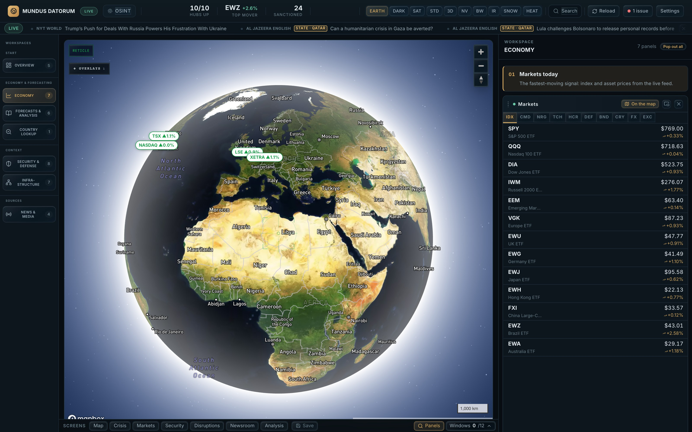
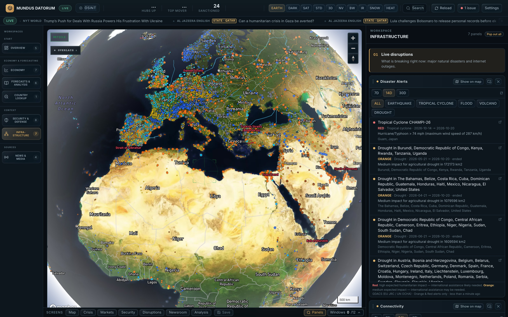
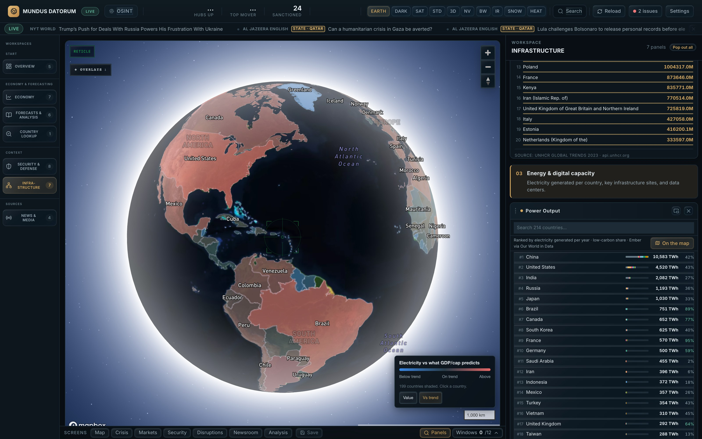
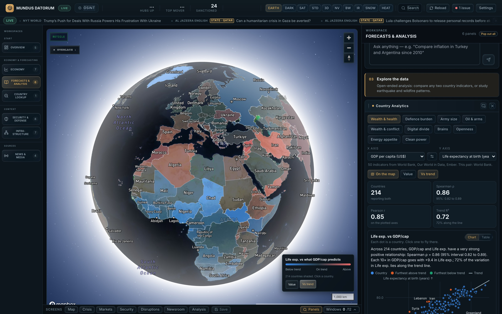
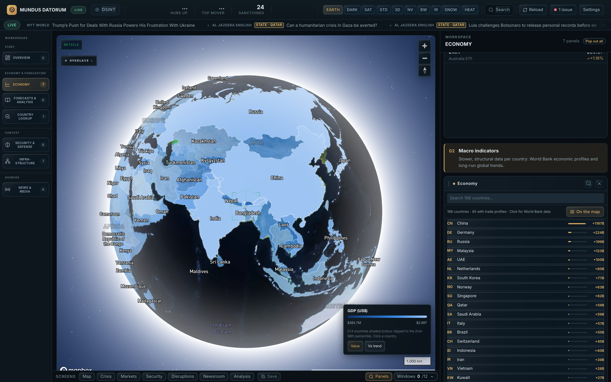
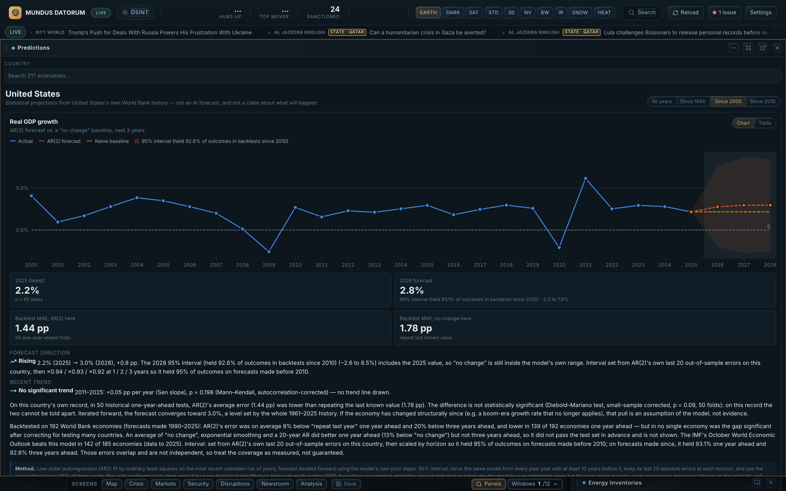
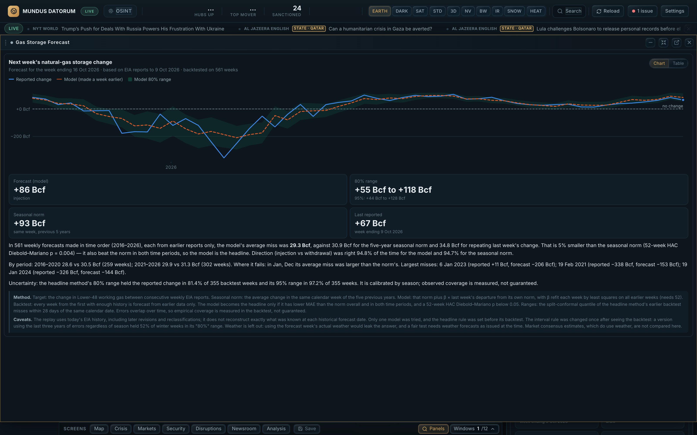
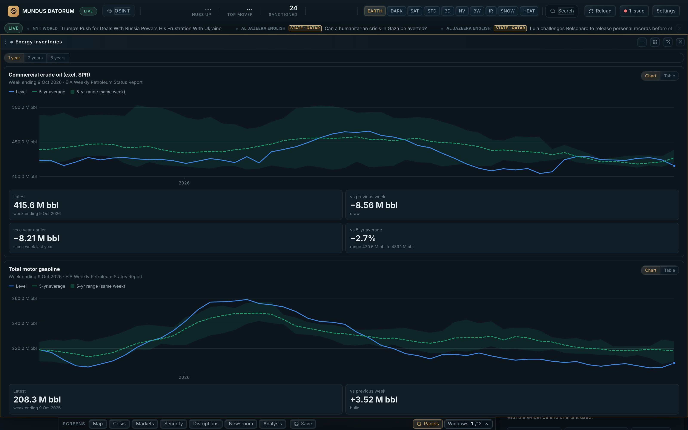

# Macroeconomic Forecasting System

A monitoring and analysis system for macroeconomic, political and industrial data — trade, sanctions, debt dynamics, conflict, hazards — on a 3D globe, with forecasts of GDP growth, inflation and unemployment whose model was chosen by an out-of-sample backtest on every World Bank economy: AR(2) for GDP growth, which beats a naive baseline on average but not the IMF, and "no change" for inflation and unemployment, where no model tested beat it.

   



## 30 overlays in 5 categories



| Category | Overlays |
|---|---|
| **Live tracking** | flights (OpenSky), vessels (AIS), webcams |
| **Events & hazards** | crises, news, wildfires (NASA FIRMS), disaster alerts (GDACS), humanitarian, GPS jamming, internet outages, hazard hexagons |
| **Security & defence** | military sites, force size, nuclear, sanctions, airspace (low-traffic heuristic, not NOTAMs) |
| **Economy** | markets, trade, resources, oil, gas, supply chain, country data |
| **Infrastructure** | energy sites, infrastructure access, data centres, pipelines, ports, chokepoints, shipping density |

Panels add what isn't a map layer, e.g. weekly energy inventories (EIA). Curated layers (military sites, energy sites, sanctions…) are hand-entered from named sources and not all re-verified; [`DATA_PROVENANCE.md`](DATA_PROVENANCE.md) says which.

Split view: the satellite map beside the embedded DeepState Ukraine battlefield monitor, with a live news feed in the dock.



Infrastructure workspace, Power Output shown on the map in *Vs trend* mode: each country is shaded by the electricity it generates against what its GDP per capita predicts (red above, blue below), and the dock ranks countries by electricity generated (Ember via Our World in Data).

## Analytics

Pick any two of **50 country indicators** (World Bank, Our World in Data, Ember) and get the trend, Spearman correlation with a 95% interval, the biggest outliers, and a globe shaded by the result. Charts have a table view; all maths is unit-tested.

| | |
|---|---|
|  |  |
| **Wealth vs health**, 214 countries, ρ = 0.86. Map in *Vs trend* mode: red lives longer than income predicts, blue shorter | **Economy data on the map**: the Economy panel's *Show on map* shades 214 countries by GDP (US$); *Vs trend* switches to the residual view |

Also: a 12×12 Spearman matrix of what moves together (click a cell to plot that pair), and ~120,000 NASA FIRMS wildfire detections binned into 3D hexagons in the browser, plus earthquakes with a Gutenberg–Richter fit.

## Forecasts

Computed in the browser, each with the backtest that decides whether it is shown. Statistical projections, not AI output.



**GDP, inflation and unemployment for 217 economies.** The headline model for each series was picked by a rolling-origin backtest across every World Bank economy: AR(2) for GDP growth (8% below "no change" one year ahead on average; the IMF still beats it in 142 of 185 economies), "no change" for inflation and unemployment, where no model tested beat it. Intervals were calibrated on forecasts made before 2010, and the label shows what they held since. Each card also backtests the model on the selected country: for the US, AR(2)'s one-year error was 1.44 pp against 1.78 pp for "no change", not a significant difference (p = 0.09).

| | |
|---|---|
|  |  |
| **Gas storage, next week**: the five-year seasonal norm plus a share of last week's departure from it. Over 561 weekly forecasts (2016–2026) its average miss was 29.3 Bcf against 30.9 Bcf for the seasonal norm (HAC Diebold–Mariano p = 0.004), and its 80% range held 81.4% of outcomes | **Energy inventories**: EIA weekly crude, gasoline, distillate, SPR and gas stocks against the same week's five-year average and range, the data the gas forecast is built on |

## An AI that reads the analytics

The analyst (any OpenRouter model, free by default) gets the comparison currently on screen as computed numbers, not as text to recall. I asked **Claude Sonnet 5.5** a data question:

> *Which countries spend far more on defence than their wealth predicts, and what explains the top two?*

- **The data**: ρ = 0.16, wealth predicts almost nothing. Ukraine is +10.7 σ above the trend.
- **The answer**: every figure matched the panel (Ukraine 34.5% vs 2.2% expected, Israel 8.8% vs 2.5%, Algeria 8.0%…). It said the wealth link is negligible and labelled its explanations "my context, not from the panel".

Those were the World Bank's 2024 values as published then. They have since been revised (as of 2026-10-15: Ukraine 2024 34.0%, Israel 8.5%), and 2025 values now exist (Ukraine 39.6%), so the live panel shows different numbers.

It also drove the map (flew to Ukraine, switched layers on). One question, one run per model: an illustration, not a benchmark.

### It can investigate on its own

Since 2026-10-16 the analyst does more than read the summary it is given. It can query every dataset the dashboard holds: live conflict events, internet outages (IODA alerts, plus Cloudflare Radar's verified outages with their stated cause), disaster alerts (GDACS), earthquakes (USGS), wildfires (FIRMS), GPS interference, headlines, market quotes, any World Bank series for any country, cross-country rankings, trade, energy, sanctions, military, resources, chokepoints, ports and UNHCR. It writes a request line (`[DATA:series|Germany,France|GDP growth]`). The browser runs the query against the same free services the panels use and returns the result, with an id (R1, R2…), for the model to cite. A single question can take up to three rounds of requests. Statistics and forecasts are computed locally, never by the model. The forecast tool uses the Predictions panel's model choice (`utils/forecastPolicy.ts`) and reports AR(2)'s out-of-sample backtest against a naive baseline on that country, so a forecast that doesn't beat "no change" is labelled as such.

Charts follow the same rule. The model writes `[CHART:R2]` to place a chart, and the panel draws it from that result's data, so the model can't supply or change a plotted value. Every answer shows an **investigation trail** listing each query, its source, success or failure, and the exact text the model received. Clicking a reference such as (R2) in the answer opens that evidence.

**Not measured:** whether the tool-using analyst is more accurate, better grounded or more useful than the single-shot version.

## Country Lookup

One country's full World Bank record since 1960 by category, ECB/Eurostat/BIS series for Europe, and a single-country analysis (trend tests, cycle, Okun, Phillips, debt dynamics, anomalies), each with method, n and caveats.

Not a decision tool: correlation is not causation, and many series are years old for some countries.

## Run it

```bash
npm install
cp .env.example .env   # only VITE_MAPBOX_TOKEN is required; every other key is optional
npm run dev            # Vite + the small /api functions that keep secrets out of the bundle
npm test               # ~1,100 tests, fully offline
```

Keys that only the owner can register (EIA) are tracked in [`TODO.md`](TODO.md).

Stack: Vite, React 18, TypeScript (strict), Mapbox GL v3, plain SVG charts. No database; state lives in the browser. A few serverless functions in `api/` keep API keys off the client and forward requests (ACLED, OpenSky, Finnhub, EIA, NYT, GPSJAM, RSS, OpenRouter). Architecture and conventions are in [`ARCHITECTURE.md`](ARCHITECTURE.md).
