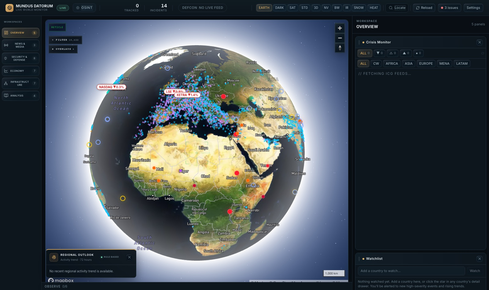
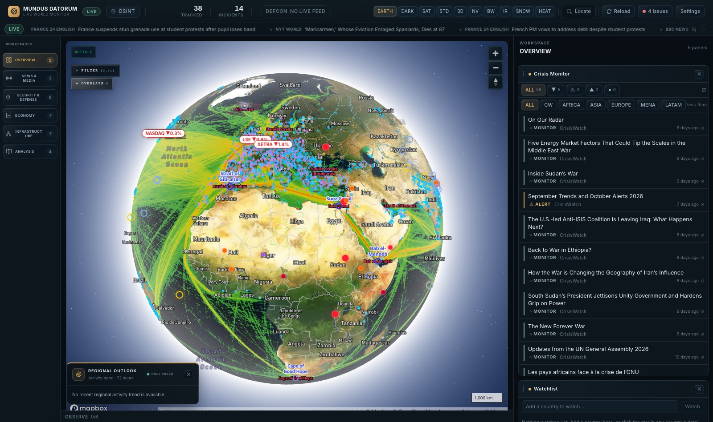
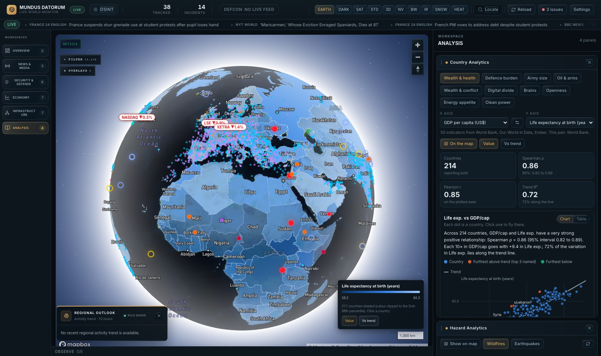
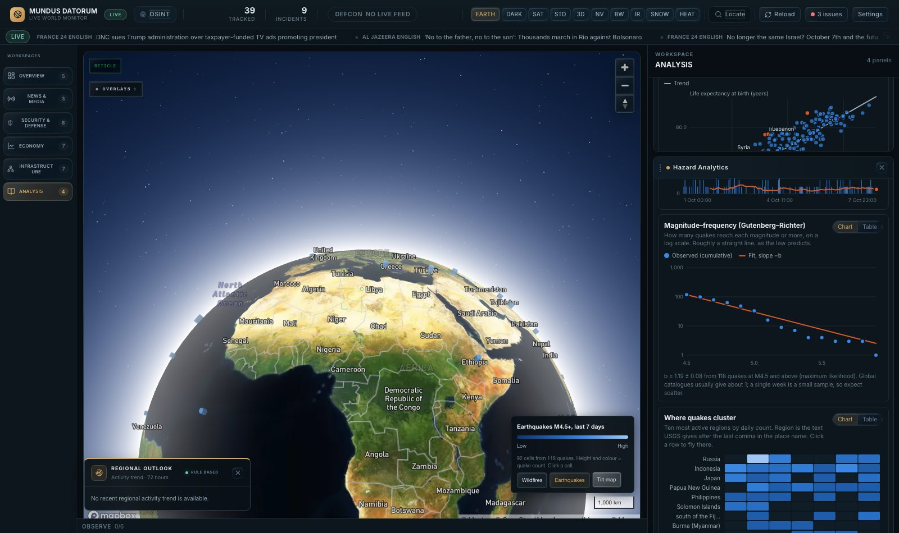
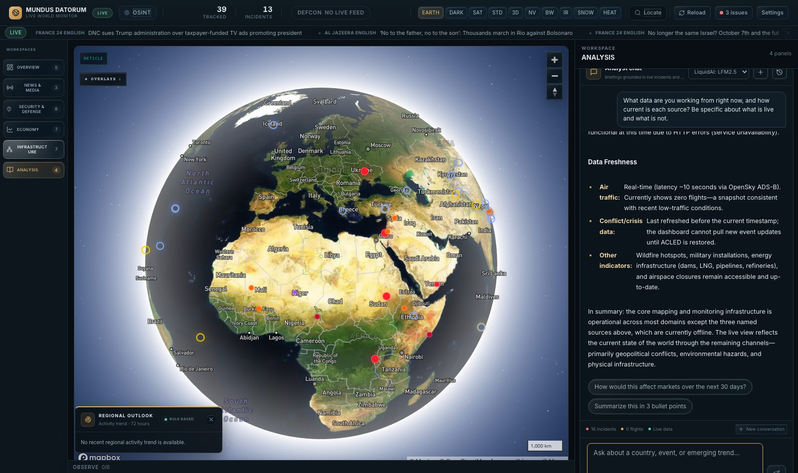

# Mundus Datorum

*Latin for "world of data" (*mundus*, world; *datorum*, genitive plural of *datum*, "that which is given").*

A real-time global situational awareness platform — a single-page command-center dashboard that fuses live flight tracking, maritime AIS data, geopolitical crisis feeds, market data, and OSINT sources onto one interactive 3D globe.

**Mundus Datorum is a research case, not a product.** It is a working apparatus for studying two things: what happens to data once it is made visible, and what happens when a language model is wired into a system that can evaluate all of it. The questions, the controls, what has been learned so far and, just as important, what has *not* been measured are set out in [Purpose and research questions](#purpose-and-research-questions).

   

## Purpose and research questions

The project treats data as the subject: what it is, where it comes from, how much of it you can actually trust, and how much changes when you choose one way of drawing it over another. It then asks what happens when an AI model is given a seat inside that system.

**Questions**

1. **Seeing.** What does data become when it is visualised? Which encodings (log versus linear axes, aggregation into hexagons, residuals against a trend, colour clipped to percentiles) surface structure, and which hide it or mislead?
2. **Evaluating.** What happens when an LLM is wired into a system that can evaluate all of it? Does it add insight, or only fluent confidence? Which constraints keep it honest, and what breaks when they are loosened?
3. **Acting.** The model can drive the interface (fly to a place, open a country, toggle layers). What does it change for a person exploring data when the thing explaining the map can also move it?
4. **Trusting.** How does a multi-source, real-time system stay honest about provenance, coverage and staleness, especially when feeds fail?

**The apparatus**

- *Data layer:* dozens of free, keyless or free-tier sources fused in the browser (flights, vessels, conflict and crisis reporting, markets, news, hazards, trade, and 50 country-level indicators from the World Bank, Our World in Data and Ember).
- *Analysis layer:* tested, deterministic statistics (Spearman correlation with confidence intervals, trend fits in axis space, outlier detection, a Gutenberg–Richter fit, a rule-based trajectory engine) that run locally, so any claim can be checked against its numbers.
- *Visualisation layer:* a 3D globe and SVG charts, each with a table view, so what is drawn can always be read as numbers.
- *AI layer:* an analyst panel (any OpenRouter model, free by default) that receives a compact summary of the live dashboard, explains numbers the system has already computed, and can issue map commands.
- *Open problem behind the engineering:* how far a real-time, multi-source system can be pushed on free-tier APIs without collapsing into ad-hoc fetch code. The answer so far is a small set of repeated patterns: one typed service and hook per source, a shared panel contract, and refresh rates budgeted to each provider's limits.

**Design choices that act as controls**

- *Real data only.* Nothing is fabricated, approximated or filled in; every static entry must trace to a named source, and empty states say so ([`CLAUDE.md`](./CLAUDE.md), [`DATA_PROVENANCE.md`](./DATA_PROVENANCE.md)).
- *Compute first, explain second.* Numbers are calculated locally, deterministically and under test; the model is asked to explain them, not to produce them. Prices, for example, may only be cited from a live snapshot injected into the prompt.
- *Separate evidence from inference.* The analyst is instructed to distinguish what the live data shows from what is its own inference, and to avoid unsupported confidence scores.
- *Free sources, free default model.* Nothing here can bill by accident; paid models are an explicit user choice.
- *The AI sees dashboard data only,* never this repository's source code, and must not claim otherwise.

**What building it has already shown**

These are observations from the build itself, not results of a controlled study:

- *Encoding choices change the finding.* Heavy-tailed indicators (GDP, population, troops) are unreadable on linear axes and sensible on log axes; a zero-filled row looks like a value until a log scale refuses to plot it; colour clipped to the 2nd–98th percentile lets ordinary countries show up next to a few giants.
- *Coverage is part of the data.* The World Bank's `MRV=1` query returned only the single latest *year*, which left internet-user data with 42 countries instead of 245. Our World in Data stores zeros for countries the Energy Institute does not report, so a "world map" of primary energy honestly covers about 78 countries. Counts per country are printed on every chart for this reason.
- *Analysis found a bug in the system's own heuristic.* The trajectory rule compared a 3-day sum with a 7-day sum, so any perfectly steady country read as "falling" by about 57%. It was only visible once the same data was plotted another way, and it had been feeding the Outlook card, the Watchlist and the AI's context.
- *Curated is not exhaustive.* Counting hand-collected bases, ports or trade profiles per country would present gaps in the list as findings, so those lists are deliberately kept out of the statistics.
- *Sources fail and decay.* GDELT's event geocoding was measured at roughly one in three top events being actual armed conflict and was dropped; ACLED publishes with a lag and, when its login fails, the system shows **NO LIVE FEED** rather than inventing a threat level.
- *Models need constraints, and the constraints have costs.* The analyst began as a prompt-only chatbot; the project then added a rule-based watchlist that computes trends first and has the model explain them. The prompt now forbids refusing, or opening with disclaimers, because a feed is down (the commit history records that change). See the transparency trade-off below for why that fix is itself a cost.

**What has not been measured, and known gaps**

- *No systematic evaluation of the AI's answers yet:* no logged sessions, no rubric for accuracy, calibration or grounding, no grounded-versus-ungrounded comparison. Treat everything the analyst says as unvalidated.
- *The analyst sees only a fraction of the data layer.* Its context is a short text summary (crisis counts, trajectory signals, flight count, source health, and live quotes for market questions). It does not receive the Country Analytics or Hazard Analytics results, so "an AI that can evaluate all of it" is only partly realised.
- *Transparency trade-off.* To stop outage disclaimers swamping answers, the prompt tells the model not to mention source outages unless asked. That improves usability and weakens exactly the honesty about coverage that question 4 is about.
- *Not measured versus zero.* The context reports `Airborne flights tracked: N` from whatever the flights hook holds, so a layer that is switched off reads as zero aircraft. In the probe above a small model concluded "no active aircraft" from it and described layers as active that the context never mentioned (see [One probe of the AI analyst](#one-probe-of-the-ai-analyst-a-single-sample-not-a-result)). The project's own history store already refuses to store a missing flight count as zero; the AI context does not yet.
- *Two grounding gaps in that context:* the capability list is static, so it still says conflict events come from ACLED when the login is failing; and conflict totals count the hand-maintained baseline markers as events without labelling them as such (the trajectory engine already excludes them).
- *Forecast validity is untested.* A walk-forward backtest of the "rising" flag was built (added in `0e6ea3a`, removed in `28323e2`) but only ever ran on synthetic test data, and it was removed when ACLED became unavailable; nothing replaces it yet, so the trajectory flags are explanatory heuristics, not validated predictors.

**Next experiments** (not done): expose the analytics as tools the model can call and compare grounded with ungrounded answers on a fixed question set; log prompts, actions and responses locally for rubric scoring; generate the capability list from live source health and label baseline markers; restore predictive validation once a dated event feed is available.

**Limits.** This is not a decision-support or forecasting tool. Correlation is not causation, many series are years old for some countries, and nothing here has been independently validated.

## Screenshots

Captured from a local run against live feeds on 7 Oct 2026 (headless Chromium, 1600×950). Nothing is mocked or retouched — including the top bar, which reads **NO LIVE FEED** and a few "issues" because the ACLED conflict feed and some rate-limited sources were not available during the capture.

| | |
|---|---|
|  |  |
| **Overview** — live flights and vessels, crisis markers, exchange chips, Crisis Monitor and Watchlist in the dock | **Layers** — chokepoints, shipping density, pipelines (OSM) and ports |
|  |  |
| **Country Analytics** — 214 countries shaded by one indicator; Spearman ρ, trend fit and outliers in the panel | **Hazard Analytics** — a day of NASA FIRMS detections binned into 3D hexagons client-side |

### The analysis in pictures

Same live, unmocked run as above (7 Oct 2026, headless Chromium, 1600×950). The numbers in the captions are the ones on screen.

| | |
|---|---|
|  |  |
| **Seeing a relationship, then its exceptions.** GDP per capita against life expectancy for 214 countries (Spearman ρ = 0.86, 72% of the variation along the trend). The map is in *Vs trend* mode: red countries live longer than their income predicts, blue shorter | **Military data on the same footing.** Population against armed forces personnel, 165 countries, ρ = 0.79 on log axes. North Korea, Eritrea and Israel sit furthest above the trend; Liberia, Haiti and Mozambique below. The map shades armed forces directly |
|  |  |
| **What moves together.** Pairwise Spearman correlations between twelve indicators. Colour is diverging around zero and every cell also prints its value, so colour never carries the number alone; click a cell to plot that pair | **A law you can check.** A week of M4.5+ earthquakes on a log axis with a maximum-likelihood fit: b = 1.19 ± 0.08 from 118 quakes, close to the value of about 1 usually reported for global catalogues |

### One probe of the AI analyst (a single sample, not a result)



I asked the default free model (LiquidAI LFM 2.5, a 2.6-billion-parameter model) one question: *"What data are you working from right now, and how current is each source? Be specific about what is live and what is not."* One run, not repeated or selected from several. For this run the flights, wildfires and markets layers were switched off and the ACLED login was failing. What happened:

- **It matched the context where the context was specific.** It reported ACLED as down (HTTP 400), the GDELT news search as rate-limited (429) and the Guardian as unauthorised (401), which is the source-health note it was given and what the app was actually experiencing.
- **It turned "not measured" into a claim about the world.** The context says `Airborne flights tracked: 0`, which is what a switched-off flights layer produces. The model read that as "no active commercial or military aircraft in the monitored area" and "a snapshot consistent with recent low-traffic conditions". The context bar in the screenshot shows the same "0 flights".
- **It described layer states it was never given.** It called the flights, wildfires, military, nuclear and airspace layers "active" or "enabled"; the context contains no layer states, and in this run flights and wildfires were off.
- **It echoed command syntax as if it were status** ("Each country flag (e.g. [COUNTRY:Iran]) is open").

One sample from one small model shows what *can* go wrong, not how often or with other models. It is the kind of failure the open questions below are about, and the reason the AI layer is described here as unevaluated.

## What it does

Mundus Datorum renders a live Mapbox GL globe with ten selectable view modes (satellite, night vision, thermal, 3D buildings, infrared, etc.) and overlays it with continuously polled data:

- **Flights** — live ICAO24 aircraft tracking via OpenSky, with type detection (military/civil/cargo) from hex ranges and callsign patterns
- **Vessels** — real-time AIS ship tracking over a WebSocket feed (AISStream)
- **Crises & conflict** — ICG CrisisWatch reporting plus, when you supply ACLED credentials, live ACLED conflict events, scored into a composite DEFCON-style threat index. Without ACLED the map shows only a short hand-maintained list of major ongoing conflicts and the top bar says **NO LIVE FEED** instead of inventing a threat level
- **Wildfires** — NASA FIRMS active fire detections
- **Markets** — indices, commodities, energy, tech, healthcare, and defense-sector tickers (Finnhub)
- **Trade & supply chain** — chokepoints, shipping density, pipelines, ports, and World Bank country economic indicators
- **News & OSINT** — aggregated reporting from Guardian, NYT, and NewsAPI, plus a keyword/coordinate search
- **Country Analytics** — pick any two of 50 country indicators (GDP, trade, population, military spending, armed forces, conflict and terrorism deaths, energy mix, R&D, life expectancy, internet access… from the World Bank, Our World in Data and Ember) and get a scatter with a fitted trend, Spearman/Pearson correlation with confidence intervals, the countries furthest above and below the trend, rankings, distributions, a 12-indicator correlation matrix, and a globe shaded by the results (see [Analytics](#analytics-comparing-countries-and-crunching-100000-detections))
- **Hazard Analytics** — the earthquake and wildfire feeds analysed in the browser, with ~100k fire detections drawn as 3D hexagons
- **AI Analyst** — an LLM-backed panel (via OpenRouter) that answers situational questions and can drive the map (fly-to, layer toggles) from natural language

All panels live in a single extensible **panel registry** (`src/panels/registry.tsx`) grouped into INTEL / GEO / MIL / FIN / AI — adding a new data source is one entry, and the dock, pop-out tray, and settings pick it up automatically.

## Analytics: comparing countries and crunching 100,000 detections

### Country Analytics (Analysis workspace)

Compare any two of **50 indicators** across all countries, in seven groups: economy, trade & finance, population, military & conflict (spending % GDP, armed forces, deaths in armed conflicts, number of conflicts, terrorism deaths), energy & resources (energy use, electricity mix, primary and renewable energy, six resource-rent series), innovation (R&D spending, researchers, patents) and society & infrastructure. Sources, all free and keyless and already used elsewhere in the app: **World Bank Open Data** (37 series), **Our World in Data** (UCDP conflict data, R&D, energy, agriculture; 9 series) and **Ember** (electricity mix, via OWID; 4 series). Start from a preset (*Wealth & health*, *Defence burden*, *Army size*, *Oil & arms*, *Wealth & conflict*, *Digital divide*, *Brains*, *Openness*, *Energy appetite*, *Clean power*) or pick the axes yourself.

| View | Method |
|---|---|
| Scatter with trend | axes follow each indicator's scale (log for heavy-tailed positives such as GDP, population, troops; symmetric-log for signed ones such as inflation and FDI); least-squares fit in axis space, so a log axis gives a log-linear trend |
| Correlation | Spearman ρ (rank-based, robust to outliers and any monotonic shape) with a 95% Fisher-z interval, plus Pearson r on the plotted axes and the trend's R²; the verdict sentence and slope reading are generated from these numbers |
| Furthest from the trend | standardised residuals: the five countries most above and most below what the fit predicts, with actual vs expected |
| Highest / distribution | top-10 ranking and a histogram (log-spaced bins for log indicators) |
| What moves together | pairwise-complete Spearman matrix for twelve indicators (needs ≥12 countries in common per cell); click a cell to plot that pair |

**Show on map from the other country panels too.** Military Personnel, Power Output, Global Trends (OWID) and Global Economy each have a *Show on map* button that points the Country Analytics layer at that panel's data, so the same globe, legend and click popup serve all of them.

**On the map**, *Show on map* shades every country by the Y indicator (colour clipped to the 2nd–98th percentile so a few giants don't wash out the rest) or, in *Vs trend* mode, by how far it sits above (red) or below (blue) the fitted trend. Click a country for its values, the trend's expectation and its distance from it.

**Data audit — what is and isn't used.** Used: every World Bank series the app already pulled in `worldbank.ts`, `militaryPersonnel.ts`, `infraIndicators.ts` and `resources.ts` (except the discontinued Ease-of-Business score), the OWID charts that are country-level (the by-region conflict-deaths chart returns no countries, so it is left out), and the Ember generation mix. Deliberately not used for statistics: the hand-curated lists (military installations, nuclear sites, ports, chokepoints, trade profiles, sanctions, data centres). Their entries are real, but the lists are not exhaustive, so counts per country would present curation gaps as findings. Live feeds with no country attribute (flights, vessels, quakes, fires) are covered by Hazard Analytics instead. Coverage varies by indicator and is shown as the number of countries on every chart (for example primary and renewable energy cover only the ~78 countries the Energy Institute reports on; OWID stores zeros for the rest, which the log axis correctly refuses to plot).

**Data handling worth knowing.** Countries are identified by ISO-3166 alpha-3, the code all three sources share and Mapbox's country boundaries expose. Each country's value is its most recent non-empty year since 2010, so years differ by country and indicator (shown on hover and in the map popup). The World Bank's `MRV=1` returns only the single latest *year*, which is empty for most countries on slow-reporting series (internet users: 42 countries instead of 245), so the client uses `mrnev=1` and discards anything older than 2010 itself because that parameter ignores the date range. Requests are cached for an hour, de-duplicated, limited to four at a time and retried once on throttling or timeouts. Formal World Bank names ("Iran, Islamic Rep.") are shortened so labels fit and place lookups work. Correlation is not causation, and military series are the World Bank's SIPRI/IISS-derived indicators, which many countries lack.

### Hazard Analytics

Works on the two high-volume feeds the app already uses — **USGS earthquakes** (M4.5+, 7 days) and **NASA FIRMS VIIRS fire detections** (24 h) — with hourly trends, a Gutenberg–Richter magnitude–frequency fit (maximum-likelihood b-value, Aki–Utsu with Shi & Bolt standard error), a region × day heatmap, depth classes, detections by UTC hour and a fire-power histogram. *Show on map* bins either feed into H3 hexagons and extrudes them (fires at res 4 by summed fire radiative power, earthquakes at res 3 by count).

**Scale.** On the run I checked (7 Oct 2026) the fire feed held 117,305 detections, which collapsed into 9,975 hexagons. Timing on *synthetic* uniformly random global points (Node, dev laptop — a worst case, since real fires cluster): 120,000 points bin into ~95,000 cells in about 0.55 s and the summary statistics take ~30 ms, so it all runs client-side.

**No data, no chart.** If a feed returns nothing or fails, its section says so and offers a retry; nothing is estimated or filled in. Every chart has a Chart / Table switch and hover and keyboard readouts, and chart colours are validated for colour-vision deficiency against the app's dark surface (`--series-1/2/3` in `index.css`, ramps in `src/utils/vizPalette.ts`).

**A bug the analytics work exposed, now fixed.** The trajectory rule used to compare a 3-day *sum* with a 7-day *sum*, so a perfectly steady country read as "falling" (about −57%) in the Outlook card, Watchlist and AI Analyst context. `computeTrajectories` now compares the last 72h with the pace the prior week implies (its score × 3/7), keeping `delta` in "points per 72h" so the flat band and boosts are unchanged.

## Tech stack

- **Vite + React 18 + TypeScript** (strict)
- **Mapbox GL JS v3** — 3D globe, custom GeoJSON layers, fill-extrusion buildings
- **Tailwind CSS** — utility styling for the surrounding chrome
- **date-fns**, **lucide-react**

No application server or database. The browser talks directly to public APIs; a few small stateless serverless functions in `api/` (Vercel format, also served by `npm run dev`) exist only to keep secrets out of the bundle (OpenSky and ACLED OAuth, Finnhub, Guardian, NYT, OpenRouter) or to add a missing CORS header (RSS, GPSJam). State lives in `localStorage`/IndexedDB.

## Architecture

```
src/
  App.tsx                    # root composition: TopBar + MapView + panel dock
  components/
    Map/MapView.tsx          # Mapbox globe composition root (~220 lines)
    Map/layers/*.ts          # one module per map layer: add*Layers() setup + use*() data hook
    Map/overlays/*.tsx       # on-map chrome: flight filter, overlay menu, legends, reticle
    TopBar.tsx                # live counters, threat index, view switcher, search
    PanelDock/                # draggable/collapsible dock + pop-out observe tray
    panels/*.tsx              # panel implementations, code-split and lazy-loaded via the registry
  panels/
    registry.tsx              # single source of truth: panel → group → render fn
    types.ts                   # shared PanelProps contract
  hooks/                      # useFlights, useVessels, useCrises, useNews, useStocks, ...
  services/                   # one API client per data source
  types/                      # shared domain types
```

Each data source follows the same shape: a `services/*.ts` client, a `hooks/use*.ts` that owns polling/refresh and exposes typed state, and a panel that renders it. New sources plug into the registry without touching the dock, tray, or settings modal.

## Running it locally

```bash
npm install
cp .env.example .env   # fill in API keys — see below
npm run dev            # Vite + the /api/*.ts functions (dev plugin reads server-only keys from .env)
```

Requires Node 18+. Open the printed local URL (defaults to `localhost:3000`). `npm run dev` serves the `api/*.ts` functions itself via `vite.api-dev.ts`, so flights (OpenSky), conflict data (ACLED), markets, Guardian/NYT news and the AI Analyst all work locally with no Vercel account. `npx vercel dev` still works if you want to mimic production exactly (it intercepts `/api/*` before it reaches Vite; it may ask to link a Vercel project — running without deploying is fine).

### API keys

Only `VITE_MAPBOX_TOKEN` is required to run the app. Everything else is optional — panels for missing keys degrade gracefully (empty state) rather than crashing. All listed providers have free tiers.

Two kinds of keys, because of how they're used:

**Client-side** (`VITE_`-prefixed, bundled into the browser build — safe here because these either have no billing risk or are meant to be public):

| Key | Service | Powers |
|---|---|---|
| `VITE_MAPBOX_TOKEN` | [Mapbox](https://console.mapbox.com) | the globe itself (**required**) — public by design, scope it to your domain from the Mapbox dashboard |
| `VITE_NEWSAPI_KEY` | [NewsAPI](https://newsapi.org) | general news search |
| `VITE_AISSTREAM_KEY` | [AISStream](https://aisstream.io) | live vessel tracking (WebSocket; read-only public AIS data) |

**Server-only** (no `VITE_` prefix — read only by the `api/*.ts` serverless functions, never shipped to the browser; set these in Vercel's project env vars for production, or in `.env` for local `vercel dev`):

| Key | Service | Powers |
|---|---|---|
| `OPENSKY_USER` / `OPENSKY_PASS` | [OpenSky Network](https://opensky-network.org) | live flight tracking |
| `ACLED_EMAIL` / `ACLED_PASSWORD` | [ACLED](https://acleddata.com) | live conflict events (optional; without it the threat index reads NO LIVE FEED) |
| `FINNHUB_KEY` | [Finnhub](https://finnhub.io) | market/sector panels |
| `GUARDIAN_KEY` / `NYT_KEY` | Guardian / NYT | news aggregation |
| `OPENROUTER_KEY` | [OpenRouter](https://openrouter.ai) | AI Analyst panel |

## Testing

```bash
npm test               # run the whole suite once (~2s, fully offline)
npm run test:watch     # re-run on change
npm run test:coverage  # v8 coverage report
npm run typecheck      # src/ + api/ + tests/
```

The suite is hermetic: `fetch` is stubbed to throw by default, so no test can touch a live API (or a paid one). It covers the pure logic (trajectory engine, flight/vessel classification), every service's parsing/caching/failure paths against mocked responses, integrity checks for the static datasets, component tests for the charts, panels and map overlays (jsdom + Testing Library), a recording-fake-map test for the map layer modules, the serverless key-injecting proxies (`tests/api/`), and repo policy checks (no committed secrets, server keys never in the client bundle). `npm run test:visual` is a separate Playwright screenshot check.

## Refresh budgeting

Every polled source runs at a rate chosen to respect its provider's free-tier limits: flights every 15s (OpenSky's polite ceiling), crises every 5 minutes, market data every 60s, news on-demand. This is deliberate — the app is designed to run indefinitely without hitting a 429.

## Status

A research apparatus under active development, not a finished study. The data, analysis and visualisation layers are built and tested; the AI layer works but has not been evaluated. The open items under [Purpose and research questions](#purpose-and-research-questions) are the current focus.

## Security notes

- `.env` is gitignored and never committed. Only `.env.example` (placeholders) is tracked.
- If you're running Claude (or any agent) against this repo inside GitHub Codespaces/Actions and it needs real API keys at runtime, use the platform's own secrets store (`Settings → Secrets and variables → Codespaces`) rather than committing `.env` — see `CLAUDE.md` for the exact commands.

## Further reading

- [`ARCHITECTURE.md`](./ARCHITECTURE.md) — data flow, panel registry pattern, map layer system
- [`DATA_PROVENANCE.md`](./DATA_PROVENANCE.md) — which data is live, which is a snapshot, which is hand-curated, and what hasn't been independently verified
- [`CLAUDE.md`](./CLAUDE.md) — working agreement for AI agents contributing to this repo
